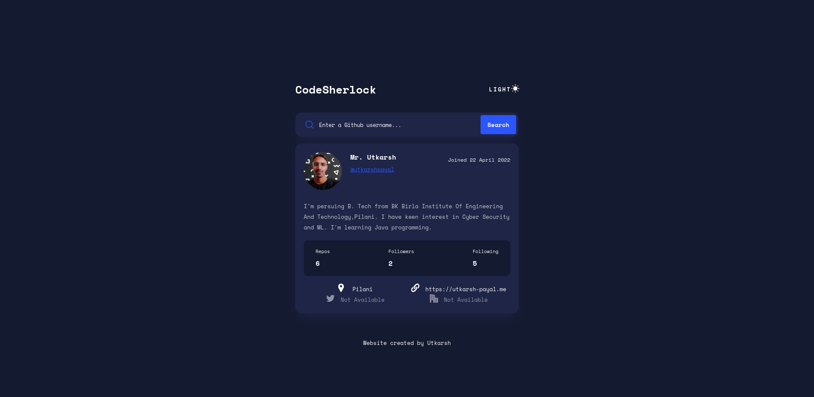

# CodeSherlock

CodeSherlock is a user profile page that interacts with the GitHub API to display information about a user's repositories, followers, following, and more.



## Features

- Search for a GitHub username (click "Search" or press Enter).
- Display user profile information: avatar, name, username, join date and bio.
- Show user repositories, followers, and following counts.
- Show location, website, Twitter and company (dimmed when not available).
- "No results" message when the user is not found.
- Dark mode toggle; the choice is saved in `localStorage` and defaults to the device's color-scheme preference.

## Tech stack

- HTML, CSS and vanilla JavaScript (no framework, no build step, no npm dependencies)
- [GitHub REST API](https://docs.github.com/en/rest/users/users#get-a-user) – `https://api.github.com/users/<username>`

## Getting Started

To use CodeSherlock, simply enter a GitHub username in the search bar and click "Search."

### Run locally

```sh
git clone https://github.com/utkarshpayal/CodeSherlock.git
cd CodeSherlock
# open index.html in your browser (or serve the folder with any static file server)
```

No API key or environment variables are needed. Requests are unauthenticated, so GitHub's unauthenticated rate limit applies.

### Deployment

The repository contains two GitHub Actions workflows for GitHub Pages (`.github/workflows/static.yml` and `.github/workflows/jekyll-gh-pages.yml`). Both are configured to run on pushes to `main`, while this repository's default branch is `master`, so they may not trigger automatically (needs confirmation); they can also be run manually via `workflow_dispatch`.

## Project structure

| Path | Purpose |
| ---- | ------- |
| `index.html` | Page markup |
| `style.css` | Styles (light and dark themes) |
| `script.js` | Search, GitHub API fetch, profile rendering, dark mode |
| `Images/` | Icons, favicons, web manifest and screenshot |

## Contributing

Feel free to contribute to this project by submitting issues or pull requests.

## Credits

- Website created by [Utkarsh](https://github.com/utkarshpayal).

---

[CodeSherlock](https://github.com/utkarshpayal/CodeSherlock)
